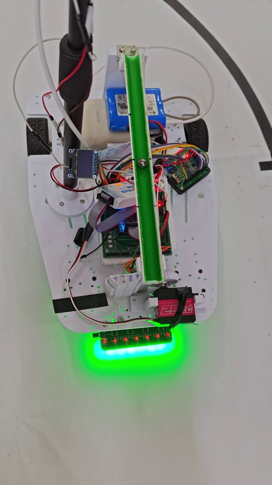
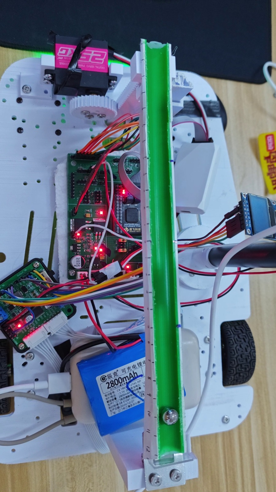

# 基于 MSPM0G3507 的循迹平衡滚球小车

> 一辆能**自己跑赛道、自己停车、并且把钢球稳在车上指定位置**的小车。
> 主控 MSPM0G3507（Cortex-M0+，80 MHz，无 FPU），视觉由 K230 提供，平衡杆用舵机闭环。

**核心指标**（实测，非仿真）

| 项目 | 指标 |
|---|---|
| 单圈完成时间 | **14.8 s / 圈**（赛道周长 6.142 m） |
| 停车瞬间钢球偏移 | **0.38 cm**（改进前 11.00 cm） |
| 钢球定点保持 | +5 cm 处稳态误差 **≤ 0.5 cm** |
| 循迹稳定性 | 连续 30 s 无丢线（7 路灰度，LOST_HOLD 300 ms 保护） |
| 视觉通信 | 14 字节自定义协议，26 px/cm 标定，帧率约 30 fps |
| 图传 | K230 WiFi 推流（可选功能，默认关闭，见 4.6） |




---

## 1. 它解决什么问题

电赛 H 题这类"车载平衡滚球"任务，难点不在单个模块，而在**三个互相打架的目标同时成立**：

1. 车要跑得快 → 但加速/刹车会让钢球因为惯性飞出去；
2. 钢球要稳 → 但舵机有齿隙、静摩擦和死区，纯 PID 抖不起来；
3. 车要停在指定位置 → 但停车瞬间的减速度是起步的 11 倍，球必飞。

这个项目把三件事拆开解决，最后合到一个 10 ms 的控制节拍里。

---

## 2. 硬件

| 部件 | 型号 / 说明 |
|---|---|
| 主控 | 逐飞 MSPM0G3507 核心板 + V1.0 主板（TI Cortex-M0+，80 MHz，无 FPU） |
| 电机 | 带编码器直流减速电机 ×2，差速驱动 |
| 循迹 | 荣洋 rydz 7 路灰度传感器（压黑线输出高电平，`IR7_ACTIVE_LOW = 0`） |
| 视觉 | K230（CanMV），UART 与主控通信，输出钢球相对画面中心的像素偏差 |
| 执行 | 舵机驱动平衡杆（中位 1726，实测零点 1660） |
| 显示 | OLED（I2C），用于在线看参数 |
| 调试 | 双模 DAP（有线 / 无线），UART 115200 打印遥测 |

---

## 3. 系统架构

```
        ┌──────────── K230 ────────────┐
        │  ball_x (像素) → err = x-320 │
        └──────────────┬───────────────┘
                 UART  14 字节协议
                       │
┌──────────────────────▼──────────────────────┐
│            MSPM0G3507 (80 MHz)             │
│                                            │
│  PIT 10 ms 中断 ──► 视觉帧同步 + 舵机 PID   │
│  PIT 编码器   ──► 速度环（左右轮）          │
│  主循环        ──► 循迹状态机 / 题序控制    │
│                    OLED / 遥测              │
└──────────────────────┬──────────────────────┘
                       │
        ┌──────────────┴──────────────┐
        │  电机 PWM + 编码器反馈      │
        │  舵机 PWM（平衡杆）         │
        └─────────────────────────────┘
```

**为什么把视觉链路放进 10 ms 中断**：最初视觉跑在主循环里，OLED 刷新把主循环拖到 9.7 Hz，舵机 PID 跟着掉帧，球直接失控。改成"中断里只做帧同步 + PID，主循环只做慢任务"之后才稳。

---

## 4. 关键技术点

### 4.1 软停车：把球从"必飞"变成"几乎不动"

**问题**：停车时固件直接 `motor_enable(0)`，减速度约 1.5–2 m/s²，是起步斜坡的 11 倍，钢球瞬间飞出 **11 cm**。

**方案**：把刹车做成斜坡——总时长不变（14.8 s），但最后 3 s 按线性递减占空比减速，同时给一个前馈补偿项抵消减速带来的惯性力。

```c
// 刹车斜坡：base_eff 从 BASE_RPM 线性降到 0
base_eff = BASE_RPM * (STOP_RAMP_MS - elapsed) / STOP_RAMP_MS;
g_stop_ff = -(START_FF_K * BASE_RPM * 10 / STOP_RAMP_MS);   // 前馈补偿
```

**结果**：球偏移 **11.00 cm → 0.38 cm**。

### 4.2 舵机抗齿隙：KD 比 KP 更重要

钢珠在小偏差时会被齿轮间隙"吃掉"响应。试过的组合里，单纯加大 KP 只会震荡，真正起作用的是**微分项**：

| 参数 | 值 | 说明 |
|---|---|---|
| `SERVO_MID_VISION` | 1726 | 视觉中位（齿轮重装后从 1660 校正回来） |
| `SERVO_KP` | −1400 | 近端 −1400 |
| `SERVO_KD` | **−70000** | 主导项，抑制齿隙带来的延迟振荡 |
| `SERVO_KI` | −25 | 积分门限 300，用于消除远端偏差 |
| `STICTION_KICK` | 250 | 起步克服静摩擦 |

**结果**：+5 cm 定点稳态误差 ≤ 0.5 cm（此前超调到 8 cm）。

### 4.3 丢线保护：区分"全白"和"全黑"

7 路灰度全白（`n=0`）和全黑（`n≥5`）是完全不同的情况，最初混在一起处理，导致起跑 1 s 被误停：

- **全白**（掉线）→ `line_lost` 路径，300 ms 后截停；
- **全黑**（十字/起跑线）→ `line_hold` 路径，只限速不停车。

`LOST_HOLD_MS` 从 100 ms 调到 **300 ms** 后，"中途突然猛停"的现象消失。

### 4.4 位置序列控制 + 锚定 PID（定点任务）

定点任务不用 bang-bang，而是"位置序列 + 到位后切 PID 锚定"：先按编码器里程走到目标附近，再切到视觉闭环精调。这样既快又不会冲过头。

### 4.5 起步不猛冲：`base_smooth` 的隐形 bug

`run_stop()` 先关 PIT，导致 IDLE 分支里 `base_smooth = 0` 永远不执行，值冻结在 149 —— 下次启动直接满速冲出去。修法：在 `run_start()` 和倒计时分支里显式清零。

### 4.6 图传：能推流，但它和"稳"是冲突的

K230 端实现了 WiFi 推流（`ENABLE_STREAM`），可以把摄像头画面实时传到电脑，用来合练、调参与录像。

**但实测开启推流后帧率下降，题 3 的超调量从 0.2 cm 恶化到 0.81 cm** —— 因为 K230 同时做图像识别和编码推流会拖慢出帧，而主控的舵机 PID 是按帧同步的。所以正式跑圈时**默认关闭推流**，只在调试/演示时开。

这条取舍比"能推流"本身更有价值：**同一个算力，要在"看得见"和"控得稳"之间分配**。

---

## 5. 遥测与调试

串口 115200 输出可解析的遥测行，便于脚本抓数据：

```
IR7: bits=1110000 (ch1..ch7) raw=0110000 n=3 ll=0 hl=0
VISION: err=  +4 status=2 age=  8 ms | servo us=1718 | kp=-1400 ki=-25 kd=-70000
pos=+0.00S | rpm L=   0 R=   3 | duty L= ... | tgt 149/149 bs=0 d=0
```

在线命令（示例）：

| 命令 | 作用 |
|---|---|
| `x=1` / `x=0` | 启动 / 停止控制定时器 |
| `t=14800` | 设定本次运行时长 |
| `m=1726` | 改舵机中位 |
| `J=<duty>` | 台架模式直接给定占空比 |
| `3=1` | 触发定点任务序列 |

---

## 6. 目录结构

```
firmware/
  user/src/        # 应用层：main / 电机 / 舵机 / 循迹 / 通信 / OLED / 中断
  user/inc/
  mdk/             # Keil MDK 工程文件（不含编译产物）
k230/
  car_vision_stream.py   # K230 端：钢球检测 + 14 字节协议发送
docs/              # 接线方案、调试记录
images/            # 实拍图 / 截图
```

## 7. 编译与复现

1. Keil MDK 打开 `firmware/mdk/SeekFree_MSPM0G3507_Device_Library.uvprojx`；
2. 依赖逐飞 MSPM0G3507 设备库（`MSPM0G3507_Library/`，未包含在本仓库）；
3. 编译下载后，串口 115200 8N1 可看遥测；
4. K230 端把 `car_vision_stream.py` 传到 CanMV，UART 与主板连接。

> 注意：接线细节见 `docs/`，其中舵机 PWM 是 **B3 不是 B4**，K230 的 RX 接 **B18**。

## 8. 已知不足

- 平衡滚球在**大偏差**（>8 cm）时收敛慢，受齿隙限制；
- 视觉在强光/反光下会丢帧，靠 K230 自恢复兜底；
- 纯 P 有 22 px 死区，必须靠积分（KI=−25，门限 300）才能从远端回中。

## 9. 演示视频

比赛现场素材共 4 段（89 秒 4K 原片），覆盖：整车跑圈、定点停车、平衡滚球、图传画面。

> 视频未入库（单文件最大 302 MB，超过 GitHub 100 MB 限制），上传 B 站后在此补链接：
>
> - 完整跑圈 + 定点停车：`<待补>`
> - 平衡滚球 + 钢球特写：`<待补>`

---

**联系方式**：闲鱼「小土ovo」　|　需要单片机/嵌入式方向的课设辅导、代码调试、硬件问题排查，可私信。

> 本项目为电赛 H 题训练车，代码以学习交流为主。
